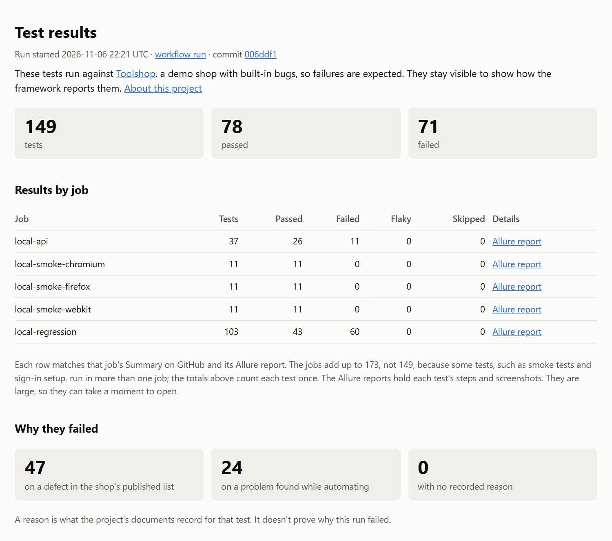
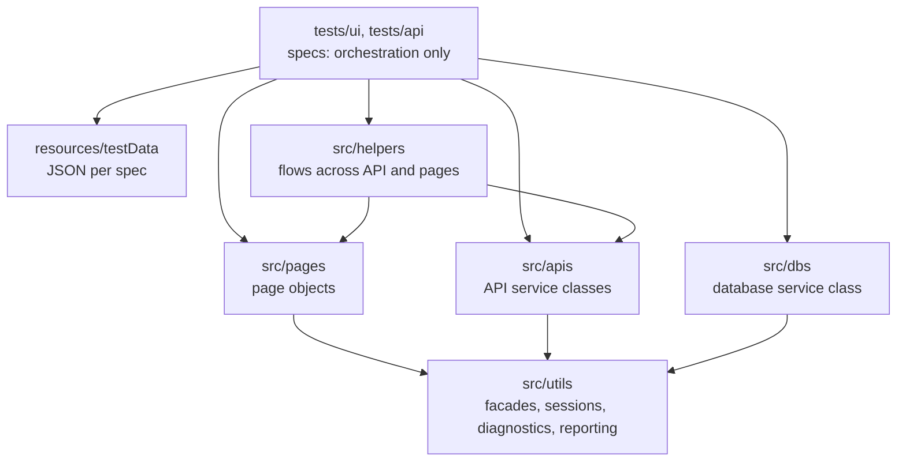
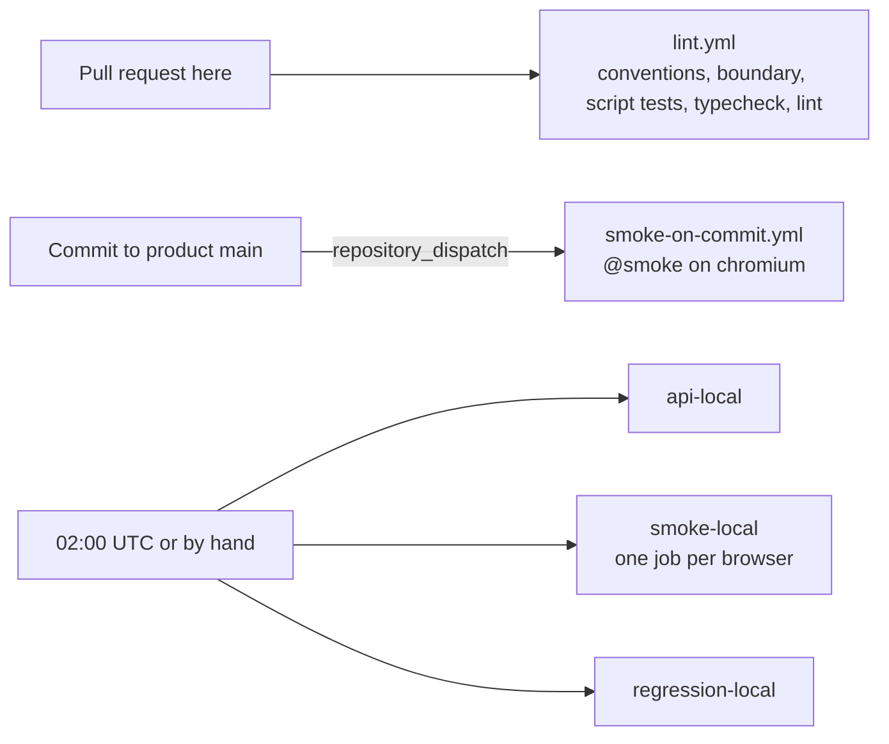

# Playwright test framework for a deliberately broken shop

[](https://github.com/AndreyPilipchenko/sample-playwright-framework/actions/workflows/lint.yml)
[](https://github.com/AndreyPilipchenko/sample-playwright-framework/actions/workflows/nightly.yml)

A Playwright + TypeScript demo framework, built for training and interview practice. It tests
[Toolshop "with-bugs"](https://with-bugs.practicesoftwaretesting.com), a public demo store that
ships with 90+ intentional defects.

**[See the latest results](https://andreypilipchenko.github.io/sample-playwright-framework/)**: the pass and fail counts, why each test failed, and the full Allure
reports, updated every night.

[](https://andreypilipchenko.github.io/sample-playwright-framework/)

*The dashboard after the run of 6 November 2026. The link above shows the latest run.*

**The tests run against a local copy of the shop in Docker.** The public site is too unstable to test
against: many people use it at once, and it sometimes breaks completely.

**Expect a red Nightly badge.** The shop's bugs are built in, and the tests catch them. A test fails when
the product doesn't do what its documentation says, and those failures stay visible to show how the
framework reports them.

## At a glance

| | |
|---|---|
| **Tests** | 147 across 30 spec files: 110 in the browser, 37 API, plus 2 sign-in setup tests. 9 are `@smoke` and also run on Firefox and WebKit |
| **Automated cases** | [116 test cases](docs/test-cases.md) from the test design |
| **Defects** | 40 distinct defects linked to failing automated tests, and [16 written bug reports](docs/bug-reports/) tied to automated tests |
| **Layers** | 25 page objects, 12 API modules, a database layer and shared technical utilities |
| **Stack** | Playwright 1.63, TypeScript 7, Node 24, Allure 3, Docker, GitHub Actions, oxlint |

## 5-minute tour

1. [The live results](https://andreypilipchenko.github.io/sample-playwright-framework/): open an Allure report from "Results by job", then a failed test, to see its
   business-titled steps and its "Browser diagnostics" attachment.
2. [`tests/ui/checkout/CheckoutTests.spec.ts`](tests/ui/checkout/CheckoutTests.spec.ts): what a spec looks like when it only orchestrates.
3. [`src/pages/ProductDetailPage.ts`](src/pages/ProductDetailPage.ts): a page object with its locators, actions and validations.
4. [`tests/api/security/`](tests/api/security/): the API-level attacks.
5. [`docs/bug-reports/cart-line-total-zero.md`](docs/bug-reports/cart-line-total-zero.md): how a failing test connects to a written bug report.

With more time, [`.github/actions/run-specs/action.yml`](.github/actions/run-specs/action.yml) shows how CI selects tests, publishes reports and compares runs.

## Quick start

```sh
npm ci
npx playwright install --with-deps chromium firefox webkit
cp .env.example .env    # add APP_ADMIN_* (demo login: docs/test-plan.md) and APP_DB_LOCAL
npm run app:up          # start the shop in Docker, freshly seeded
npm run test:local      # run the suite against it; opens the Allure report after
```

Expect red tests: see above. `npm test` runs against the shared public site instead of Docker, but
the private stack is the better first run, because some specs need its database and mail inbox. Without
the two `.env` values, the admin and disabled-account specs fail ([details](#running-the-app-locally)).

## What's worth a look

| Problem | What the framework does | Where |
|---|---|---|
| **One new failure among 70 is easy to miss** | The CI summary compares with the previous run and separates newly failing, fixed and still failing tests | [`scripts/ci-summary.mjs`](scripts/ci-summary.mjs) |
| **Logging in before every test is slow, and repeated logins put a shared account at risk** | Each role signs in once per run. The session is saved to a gitignored file, and tests that opt into a role reuse it, restored through an init script because the app keeps it in sessionStorage, which Playwright's `storageState` can't save. Passwords stay in `.env` or GitHub secrets | [`AuthSession.ts`](src/utils/AuthSession.ts), [`fixtures/test.ts`](src/fixtures/test.ts) |
| **One failed login locks an account** (defect #21), so a retry can do damage | Customers are throwaway accounts registered through the API, and the sign-in specs never retry | [`auth.setup.ts`](setup/auth.setup.ts) |
| **"Why did it fail?" often isn't in the assertion** | A failed test gets a report of what the browser did: console errors, failed requests, 5xx responses, dialogs, new tabs and toasts | [`BrowserDiagnostics.ts`](src/utils/BrowserDiagnostics.ts) |
| **Toast messages cover the controls under them** | A fixture holds the test until the toast fades, and specs that read toasts turn this off | [`fixtures/test.ts`](src/fixtures/test.ts) |
| **Some behaviour can't be reached through the UI or API** | Disabling an account goes through the database, a discount depends on the browser's position, and a contact message is checked in the local mail inbox | [`DbsUserAccount.ts`](src/dbs/DbsUserAccount.ts), [`BrowserGeolocation.ts`](src/utils/BrowserGeolocation.ts), [`ApisMailInbox.ts`](src/apis/ApisMailInbox.ts) |
| **Security needs testing too** | API specs try another customer's record, forged invoice prices, deletes without a token and guarded GraphQL fields | [`tests/api/security/`](tests/api/security/) |
| **Reports in a public repository can leak logins** | Allure masks typed passwords, the two places that type the admin password record no trace, and the HTML report is published only on request | [Report masking](docs/harness-change-requests/report-credential-masking.md) |
| **A wrong report misleads as much as a wrong test** | The scripts behind the run summary, dashboard, secret check and boundary check have their own tests, run on every pull request | [`scripts/tests`](scripts/tests) |
| **Code style slips when only a reviewer checks it** | Every pull request runs a mechanical conventions check, a core boundary check, typecheck and lint | [`lint.yml`](.github/workflows/lint.yml) |

## How it's built

Specs only orchestrate. Business meaning lives in page objects and service classes, and anything
technical stays in `src/utils/`.



Tests never run on commits to this repository, because it's the test project, not the product. A
commit to the product repository triggers the smoke tests, and the full suite runs every night.



Each test job brings up its own Docker copy of the shop, so jobs can't disturb each other, and one
job's failure doesn't stop the others.

## Reports

| Report | Where | Notes |
|---|---|---|
| **Allure** | `reports/allure-report/index.html`; CI artifact `allure-report-<job>` | Main report, with business-titled steps. Opens after a local run (`AUTO_ALLURE_OPEN=false` turns that off) |
| **Traces** | `test-results/`; CI artifact `traces-<job>`, kept for 7 days | One per failed test. Open with `npx playwright show-trace trace.zip` |
| **Results dashboard** | [Live site](https://andreypilipchenko.github.io/sample-playwright-framework/), or locally `reports/quality-dashboard/index.html`: run `node scripts/quality-dashboard.mjs local=reports/json-report/test-results.json` after a run | Pass and fail counts by area, and the recorded reason for each failure |
| **CI summary** | The run's Summary page | Counts, failures with their assertion, and what changed since the last run |
| **Playwright HTML** | `reports/playwright-report/`; CI only when `PUBLISH_REPORTS` is `true` | Open with `npx playwright show-report reports/playwright-report` |
| **JSON, JUnit, CTRF** | `reports/json-report/`, `reports/junit/`, `ctrf/` | For other tools |

## Project structure

```
src/pages/    GUI business layer — page classes (locators + actions + validations)
src/apis/     API business layer — service classes per domain (accounts, catalog, invoices, users, logs, GraphQL)
src/dbs/      DB business layer — DbsUserAccount (local stack only, see Running the app locally)
src/helpers/  Flows across the API and several pages, shared by specs (CustomerFlows)
src/utils/    Reusable core: technical layer — ApiActions/DBActions facades, Allure/report plumbing
src/config/   App settings: environment & target coordinates (reads .harness/targets.json / .env)
src/fixtures/ Reusable core: the suite's `test` with the `role` option (signed-in sessions)
tests/        Spec files, in ui/<category>/ and api/<category>/ — orchestrate business flows, carry Allure metadata only
setup/        Setup project — signs each role in once per run
resources/    testData/ (per-spec JSON files), Queries/ and apisCollections/ (team libraries)
.harness/     Harness-managed project config, targets and the vendored package
```

The framework was built with AI agents working from the `playwright-pom-harness` skill library, so
its conventions are written down and checked. See `AGENTS.md` / `CLAUDE.md` for the skill routing, and
`node_modules/playwright-pom-harness/docs/` for the full conventions reference.

Run Playwright from the repository root. Specs load their test data from
repo-root-relative paths (`./resources/testData/...`, the harness test-data
convention, which `check-conventions` verifies), so launching from a subfolder with
`-c` fails with `ENOENT`. npm scripts, CI and the VS Code extension already run from the root.

Check harness readiness any time with `npx --no pom-harness check`, and enforce POM
conventions with `npx --no pom-harness check-conventions`.

## Test documentation

[`docs/`](docs/README.md) holds the test documentation for the application under test,
compiled from the upstream Practice Software Testing docs:

- [Test plan](docs/test-plan.md): scope, environment, approach, risks, and the treatment of
  tests for a deliberately broken target
- [Test cases](docs/test-cases.md): test conditions per feature area, traced to upstream
  acceptance criteria
- [Known defects](docs/known-defects.md): the defect register, and how test cases map to it
- [Bug reports](docs/bug-reports/): written reports with their reproductions
- [Automated tests](docs/automated-tests.md): every spec, the cases it covers and which are red

### Not automated yet

The per-area count of automated cases is the Coverage summary in
`docs/test-cases.md`. Not automated yet, among others: admin (TC-ADM-1, 3, 4, 10, 11), contact (TC-CONT-1, 2, 4 to 7, 10 to 12), chat (all but TC-CHAT-6), discounts
(TC-DISC-2, 3, 7), the remaining API cases (TC-API-5, 7, 12 to 15) and accessibility. Every P1 case of the checkout sign-in,
address and payment steps, login and registration is automated; the catalog, cart and discount P1 cases are automated too.

## Signed-in tests

The `setup` project (`setup/auth.setup.ts`) signs each role in once per run and saves
its session to the gitignored `playwright/.auth/`. The app keeps its token in
sessionStorage, which Playwright's `storageState` does not capture, so specs opt in through
the `role` fixture instead:

```ts
import { test } from '../../../src/fixtures/test'; // conventions-ok: session and browser diagnostics fixture

test.use({ role: 'customer' }); // or 'admin'
```

The customer is a disposable account the setup registers through the API every run, so no
shared customer credential is needed or reported. The admin cannot be created that way: it
comes from `.env` (`APP_ADMIN_*`, see `.env.example`) and is skipped when unset. The setup
never retries, because this target locks an account after **one** failed login (known defect
#21). On CI the two admin variables come from the repository's GitHub Actions secrets, mapped
onto the spec-running steps of both workflows.

Native report detail can contain the admin credentials: Playwright step titles
(`Fill "<value>"`), failure pages and traces. The Allure report masks what is typed into a
password-like field (`Fill "***"`, see `REDACTED_FIELD_LOCATOR` in `src/utils/RedactedKeys.ts`),
so CI always attaches it; account emails stay readable there. It leaves traces out: CI attaches
failed tests' traces as a separate `traces-<report-name>` artifact, kept for 7 days (open one with
`npx playwright show-trace trace.zip`). `setup` and `tests/ui/accounts/LoginTests.spec.ts`, which type
the admin password, record none. This repository is
public, so the jobs that sign in attach the Playwright HTML report (failure pages, step titles) only
when the repository variable `PUBLISH_REPORTS` is `true` (set it once the repository is
private). The run's Summary page always shows the results. See
[docs/harness-change-requests/report-credential-masking.md](docs/harness-change-requests/report-credential-masking.md).

## Running the app locally

This is how the suite is meant to run, and what CI does. The public instance is too unstable to
test against: many people use it at once, and it sometimes breaks completely. A local copy in
Docker gives every run a clean, freshly seeded dataset that nobody else touches, and works offline.
A plain `npm test`, without `TEST_ENV=local`, still targets the public instance.

Requires Docker and free ports `4200`, `8091`, `3306`, `1080`.


```sh
npm run app:up        # start and seed the stack (first run pulls ~1.5 GB of images)
npm run test:local    # run the suite against http://localhost:4200
npm run app:status    # readiness and container state
npm run app:logs      # container logs
npm run app:down      # stop it (add -- --volumes to drop the data too)
```

`scripts/app.mjs` backs these — it downloads the upstream project's
`docker-compose.prod.yml` into a gitignored `.app/` directory and runs the prebuilt
images, so no application source is cloned. Useful options:

```sh
node scripts/app.mjs up --variant sprint5 --timeout 900   # a different upstream build
node scripts/app.mjs test -- --headed --project=chromium  # pass args through to Playwright
```

The local instance is a harness environment, `local`, defined in
`.harness/project.json`. Its browser and API targets are `app-local` in
`.harness/targets.json`. `TEST_ENV` selects the environment, and
`src/config/targets.ts` resolves every address from it; without `TEST_ENV` the
default environment, `practice` (the public instance), is used. Any Playwright
invocation honours it:

```sh
TEST_ENV=local npx playwright test
```

The local stack also has a database (target `appDb-local`). Specs that need it read its credentials
as JSON from `APP_DB_LOCAL` in `.env`, shaped `APP_DB_LOCAL='{"user":"…","password":"…"}'`, with the
`MYSQL_USER` / `MYSQL_PASSWORD` values from `.app/docker-compose.prod.yml`; the nightly `api-local` and
`regression-local` jobs read the secret of the same name.
Only the disabled-account cases use it (TC-LOGIN-10, `customer-account-api-6`): this build's admin
API cannot disable an account. Without it they fail with a database connection error.

To point a single run at another address without adding an environment, override it
per name: `APP_URL` for the UI, `APP_API_URL` for the API.

The stack starts the UI on `4200`, the REST API on `8091` (Swagger at
`:8091/api/documentation`) and MariaDB on `3306`. A `mailcatcher` sink (inbox on `1080`) is added
because the API sends mail on checkout and the upstream compose file defines no mail host; without it
`POST /invoices` returns 500. Note that the upstream `web` (nginx)
and `cron` images are published for **linux/arm64 only** — Docker Desktop emulates
them transparently, but a bare amd64 Linux host needs binfmt handlers registered
(`docker run --privileged --rm tonistiigi/binfmt --install arm64`), which is what the
CI job's QEMU step does.

## CI

Two workflows run the tests. This repository is the test project, not the product, so
**commits and pull requests here run no Playwright tests**: a pull request runs only the static checks (`.github/workflows/lint.yml`: conventions, core boundary, script tests, type-check, lint).

| Workflow | Runs | When |
|---|---|---|
| `smoke-on-commit.yml` | `@smoke` tests on chromium | Every commit to the product repository's `main`: its workflow sends a `repository_dispatch` of type `product-main-push`; the run is titled with the product commit (`Smoke: <repo>@<sha>`) |
| `nightly.yml` | all tests, in separate jobs, then publishes the results to GitHub Pages | 02:00 UTC every night (GitHub runs schedules on the default branch only) |

Both can also be started by hand, narrowed by tag, test title or path, or pointed at another deployment.
Every job writes its results to the run's Summary page, with failures split into newly failing, fixed
and still failing. The [CI guide](docs/ci-guide.md) covers the manual inputs, the nightly jobs and the
shared composite actions.

### Connecting the product repository

The trigger that the product repository needs, and its instructions, are in
[`docs/ci/`](docs/ci/README.md): a workflow to copy into the product repository
([`product-repo-trigger.yml`](docs/ci/product-repo-trigger.yml)) and a README for that
repository covering the token, the secret, how to check it works and troubleshooting. Both
live under `docs/` so they never run here.

## Using it on another app

`src/utils` and `src/fixtures` are the reusable core, and `src/config` holds the settings. Everything else is specific
to Toolshop. [`scripts/check-core-boundary.mjs`](scripts/check-core-boundary.mjs) runs on every pull request and fails
when core names the app or imports a Toolshop layer, or when two tests share a case ID. The
[adapting guide](docs/adapting-to-your-app.md) lists what to change; it hasn't been tried on another app yet.

## License

The framework code and tests are under the [MIT license](LICENSE). The Toolshop application and the test
documents derived from its documentation stay under Testsmith's terms; see [NOTICE](NOTICE.md).
