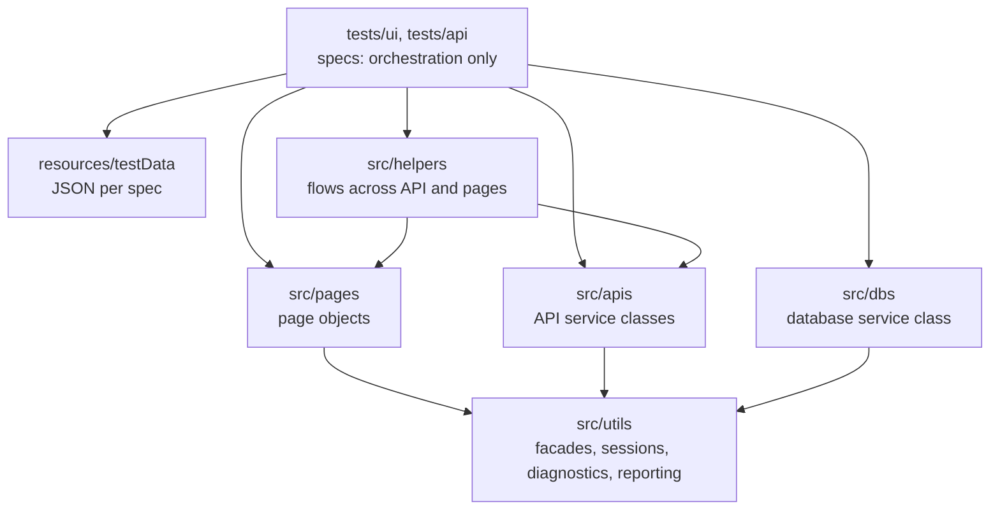
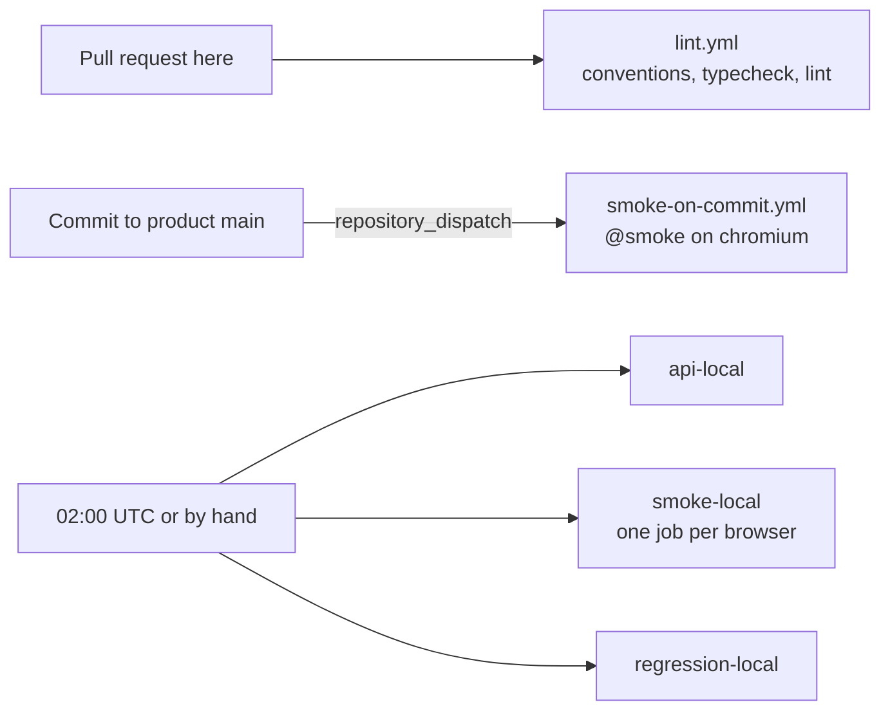

# Playwright test framework for a deliberately broken shop

[](https://github.com/AndreyPilipchenko/sample-playwright-framework/actions/workflows/lint.yml)
[](https://github.com/AndreyPilipchenko/sample-playwright-framework/actions/workflows/nightly.yml)

A Playwright + TypeScript demo framework, built for training and interview practice. It tests
[Toolshop "with-bugs"](https://with-bugs.practicesoftwaretesting.com), a public demo store that
ships with 90+ intentional defects.

**[See the latest results](https://andreypilipchenko.github.io/sample-playwright-framework/)**: the pass and fail counts, why each test failed, and the full Allure
reports, updated every night.

**The tests run against a local copy of the shop in Docker.** The public site is too unstable to test
against: many people use it at once, and it sometimes breaks completely.

**Expect a red Nightly badge.** The shop's bugs are built in, and the tests catch them. A test fails when
the product doesn't do what its documentation says, and those failures stay visible to show how the
framework reports them. Latest full local run (6 November 2026, chromium and API): 78 passed, 71 failed.

## At a glance

| | |
|---|---|
| **Tests** | 147 across 30 spec files: 110 in the browser, 37 API, plus 2 sign-in setup tests. 9 are `@smoke` and also run on Firefox and WebKit |
| **Automated cases** | [116 test cases](docs/test-cases.md) from the test design |
| **Defects** | 40 distinct defects linked to failing automated tests, and [16 written bug reports](docs/bug-reports/) tied to automated tests |
| **Layers** | 25 page objects, 12 API modules, a database layer and shared technical utilities |
| **Stack** | Playwright 1.63, TypeScript 7, Node 24, Allure 3, Docker, GitHub Actions, oxlint |

## Quick start

```sh
npm ci
npx playwright install --with-deps chromium firefox webkit
cp .env.example .env    # add APP_ADMIN_* (demo login: docs/test-plan.md) and APP_DB_LOCAL
npm run app:up          # start the shop in Docker, freshly seeded
npm run test:local      # run the suite against it; opens the Allure report after
```

Expect red tests: see above. `npm test` runs against the shared public site instead of Docker, but
the private stack is the better first run, because some specs need its database and mail inbox. Without
the two `.env` values, the admin and disabled-account specs fail ([details](#running-the-app-locally)).

## What's worth a look

| Problem | What the framework does | Where |
|---|---|---|
| **One new failure among 70 is easy to miss** | The CI summary compares with the previous run and separates newly failing, fixed and still failing tests | [`scripts/ci-summary.mjs`](scripts/ci-summary.mjs) |
| **Logging in before every test is slow, and repeated logins put a shared account at risk** | Each role signs in once per run. The session is saved to a gitignored file, and tests that opt into a role reuse it, restored through an init script because the app keeps it in sessionStorage, which Playwright's `storageState` can't save. Passwords stay in `.env` or GitHub secrets | [`AuthSession.ts`](src/utils/AuthSession.ts), [`fixtures/test.ts`](src/fixtures/test.ts) |
| **One failed login locks an account** (defect #21), so a retry can do damage | Customers are throwaway accounts registered through the API, and the sign-in specs never retry | [`auth.setup.ts`](setup/auth.setup.ts) |
| **"Why did it fail?" often isn't in the assertion** | A failed test gets a report of what the browser did: console errors, failed requests, 5xx responses, dialogs, new tabs and toasts | [`BrowserDiagnostics.ts`](src/utils/BrowserDiagnostics.ts) |
| **Toast messages cover the controls under them** | A fixture holds the test until the toast fades, and specs that read toasts turn this off | [`fixtures/test.ts`](src/fixtures/test.ts) |
| **Some behaviour can't be reached through the UI or API** | Disabling an account goes through the database, a discount depends on the browser's position, and a contact message is checked in the local mail inbox | [`DbsUserAccount.ts`](src/dbs/DbsUserAccount.ts), [`BrowserGeolocation.ts`](src/utils/BrowserGeolocation.ts), [`ApisMailInbox.ts`](src/apis/ApisMailInbox.ts) |
| **Security needs testing too** | API specs try another customer's record, forged invoice prices, deletes without a token and guarded GraphQL fields | [`tests/api/security/`](tests/api/security/) |
| **Reports in a public repository can leak logins** | Allure masks typed passwords, the two places that type the admin password record no trace, and the HTML report is published only on request | [Report masking](docs/harness-change-requests/report-credential-masking.md) |
| **Code style slips when only a reviewer checks it** | Every pull request runs a mechanical conventions check, typecheck and lint | [`lint.yml`](.github/workflows/lint.yml) |

## How it's built

Specs only orchestrate. Business meaning lives in page objects and service classes, and anything
technical stays in `src/utils/`.



Tests never run on commits to this repository, because it's the test project, not the product. A
commit to the product repository triggers the smoke tests, and the full suite runs every night.



Each test job brings up its own Docker copy of the shop, so jobs can't disturb each other, and one
job's failure doesn't stop the others.

### Where to start reading

1. [`tests/ui/checkout/CheckoutTests.spec.ts`](tests/ui/checkout/CheckoutTests.spec.ts): what a spec looks like when it only orchestrates.
2. [`src/pages/ProductDetailPage.ts`](src/pages/ProductDetailPage.ts): a page object with its locators, actions and validations.
3. [`tests/api/security/`](tests/api/security/): the API-level attacks.
4. [`docs/bug-reports/cart-line-total-zero.md`](docs/bug-reports/cart-line-total-zero.md): how a failing test connects to a written bug report.
5. [`.github/actions/run-specs/action.yml`](.github/actions/run-specs/action.yml): how CI selects tests, publishes reports and compares runs.

## Reports

| Report | Where | Notes |
|---|---|---|
| **Allure** | `reports/allure-report/index.html`; CI artifact `allure-report-<job>` | Main report, with business-titled steps. Opens after a local run (`AUTO_ALLURE_OPEN=false` turns that off) |
| **Traces** | `test-results/`; CI artifact `traces-<job>`, kept for 7 days | One per failed test. Open with `npx playwright show-trace trace.zip` |
| **Results dashboard** | [Live site](https://andreypilipchenko.github.io/sample-playwright-framework/), or locally `reports/quality-dashboard/index.html`: run `node scripts/quality-dashboard.mjs local=reports/json-report/test-results.json` after a run | Pass and fail counts by area, and the recorded reason for each failure |
| **CI summary** | The run's Summary page | Counts, failures with their assertion, and what changed since the last run |
| **Playwright HTML** | `reports/playwright-report/`; CI only when `PUBLISH_REPORTS` is `true` | Open with `npx playwright show-report reports/playwright-report` |
| **JSON, JUnit, CTRF** | `reports/json-report/`, `reports/junit/`, `ctrf/` | For other tools |

## Project structure

```
src/pages/    GUI business layer — page classes (locators + actions + validations)
src/apis/     API business layer — service classes per domain (accounts, catalog, invoices, users, logs, GraphQL)
src/dbs/      DB business layer — DbsUserAccount (local stack only, see Running the app locally)
src/helpers/  Flows across the API and several pages, shared by specs (CustomerFlows)
src/utils/    Technical layer — ApiActions/DBActions facades, Allure/report plumbing
src/config/   Environment & target coordinates (reads .harness/targets.json / .env)
src/fixtures/ The suite's `test` with the `role` option (signed-in sessions)
tests/        Spec files, in ui/<category>/ and api/<category>/ — orchestrate business flows, carry Allure metadata only
setup/        Setup project — signs each role in once per run
resources/    testData/ (per-spec JSON files), Queries/ and apisCollections/ (team libraries)
.harness/     Harness-managed project config, targets and the vendored package
```

The framework was built with AI agents working from the `playwright-pom-harness` skill library, so
its conventions are written down and checked. See `AGENTS.md` / `CLAUDE.md` for the skill routing, and
`node_modules/playwright-pom-harness/docs/` for the full conventions reference.

Run Playwright from the repository root. Specs load their test data from
repo-root-relative paths (`./resources/testData/...`, the harness test-data
convention, which `check-conventions` verifies), so launching from a subfolder with
`-c` fails with `ENOENT`. npm scripts, CI and the VS Code extension already run from the root.

Check harness readiness any time with `npx --no pom-harness check`, and enforce POM
conventions with `npx --no pom-harness check-conventions`.

## Test documentation

[`docs/`](docs/README.md) holds the test documentation for the application under test,
compiled from the upstream Practice Software Testing docs:

- [Test plan](docs/test-plan.md): scope, environment, approach, risks, and the treatment of
  tests for a deliberately broken target
- [Test cases](docs/test-cases.md): test conditions per feature area, traced to upstream
  acceptance criteria
- [Known defects](docs/known-defects.md): the defect register, and how test cases map to it
- [Bug reports](docs/bug-reports/): written reports with their reproductions

## Signed-in tests

The `setup` project (`setup/auth.setup.ts`) signs each role in once per run and saves
its session to the gitignored `playwright/.auth/`. The app keeps its token in
sessionStorage, which Playwright's `storageState` does not capture, so specs opt in through
the `role` fixture instead:

```ts
import { test } from '../../../src/fixtures/test'; // conventions-ok: session and browser diagnostics fixture

test.use({ role: 'customer' }); // or 'admin'
```

The customer is a disposable account the setup registers through the API every run, so no
shared customer credential is needed or reported. The admin cannot be created that way: it
comes from `.env` (`APP_ADMIN_*`, see `.env.example`) and is skipped when unset. The setup
never retries, because this target locks an account after **one** failed login (known defect
#21). On CI the two admin variables come from the repository's GitHub Actions secrets, mapped
onto the spec-running steps of both workflows.

Native report detail can contain the admin credentials: Playwright step titles
(`Fill "<value>"`), failure pages and traces. The Allure report masks what is typed into a
password-like field (`Fill "***"`, see `REDACTED_FIELD_LOCATOR` in `src/utils/RedactedKeys.ts`),
so CI always attaches it; account emails stay readable there. It leaves traces out: CI attaches
failed tests' traces as a separate `traces-<report-name>` artifact, kept for 7 days (open one with
`npx playwright show-trace trace.zip`). `setup` and `tests/ui/accounts/LoginTests.spec.ts`, which type
the admin password, record none. This repository is
public, so the jobs that sign in attach the Playwright HTML report (failure pages, step titles) only
when the repository variable `PUBLISH_REPORTS` is `true` (set it once the repository is
private). The run's Summary page always shows the results. See
[docs/harness-change-requests/report-credential-masking.md](docs/harness-change-requests/report-credential-masking.md).

## Running the app locally

This is how the suite is meant to run, and what CI does. The public instance is too unstable to
test against: many people use it at once, and it sometimes breaks completely. A local copy in
Docker gives every run a clean, freshly seeded dataset that nobody else touches, and works offline.
A plain `npm test`, without `TEST_ENV=local`, still targets the public instance.

Requires Docker and free ports `4200`, `8091`, `3306`, `1080`.


```sh
npm run app:up        # start and seed the stack (first run pulls ~1.5 GB of images)
npm run test:local    # run the suite against http://localhost:4200
npm run app:status    # readiness and container state
npm run app:logs      # container logs
npm run app:down      # stop it (add -- --volumes to drop the data too)
```

`scripts/app.mjs` backs these — it downloads the upstream project's
`docker-compose.prod.yml` into a gitignored `.app/` directory and runs the prebuilt
images, so no application source is cloned. Useful options:

```sh
node scripts/app.mjs up --variant sprint5 --timeout 900   # a different upstream build
node scripts/app.mjs test -- --headed --project=chromium  # pass args through to Playwright
```

The local instance is a harness environment, `local`, defined in
`.harness/project.json`. Its browser and API targets are `app-local` in
`.harness/targets.json`. `TEST_ENV` selects the environment, and
`src/config/targets.ts` resolves every address from it; without `TEST_ENV` the
default environment, `practice` (the public instance), is used. Any Playwright
invocation honours it:

```sh
TEST_ENV=local npx playwright test
```

The local stack also has a database (target `appDb-local`). Specs that need it read its credentials
as JSON from `APP_DB_LOCAL` in `.env`, shaped `APP_DB_LOCAL='{"user":"…","password":"…"}'`, with the
`MYSQL_USER` / `MYSQL_PASSWORD` values from `.app/docker-compose.prod.yml`; the nightly `api-local` and
`regression-local` jobs read the secret of the same name.
Only the disabled-account cases use it (TC-LOGIN-10, `customer-account-api-6`): this build's admin
API cannot disable an account. Without it they fail with a database connection error.

To point a single run at another address without adding an environment, override it
per name: `APP_URL` for the UI, `APP_API_URL` for the API.

The stack starts the UI on `4200`, the REST API on `8091` (Swagger at
`:8091/api/documentation`) and MariaDB on `3306`. A `mailcatcher` sink (inbox on `1080`) is added
because the API sends mail on checkout and the upstream compose file defines no mail host; without it
`POST /invoices` returns 500. Note that the upstream `web` (nginx)
and `cron` images are published for **linux/arm64 only** — Docker Desktop emulates
them transparently, but a bare amd64 Linux host needs binfmt handlers registered
(`docker run --privileged --rm tonistiigi/binfmt --install arm64`), which is what the
CI job's QEMU step does.

## CI

Two workflows run the tests. This repository is the test project, not the product, so
**commits and pull requests here run no tests**: a pull request runs only the static checks (`.github/workflows/lint.yml`: conventions, type-check, lint).

| Workflow | Runs | When |
|---|---|---|
| `smoke-on-commit.yml` | `@smoke` tests on chromium | Every commit to the product repository's `main`: its workflow sends a `repository_dispatch` of type `product-main-push`; the run is titled with the product commit (`Smoke: <repo>@<sha>`) |
| `nightly.yml` | all tests, in separate jobs, then publishes the results to GitHub Pages | 02:00 UTC every night (GitHub runs schedules on the default branch only) |

Both can be started by hand (Actions → Run workflow, or `gh workflow run smoke-on-commit.yml`
/ `gh workflow run nightly.yml`). Smoke runs queue behind each other, and a burst of product
commits tests only the newest one; nightly runs have their own queue, so a product commit never
cancels a waiting nightly run.

A manual run takes optional inputs (all blank = as configured):

| Input | Effect |
|---|---|
| `app_url`, `api_url` | Test another deployment: become `APP_URL` / `APP_API_URL` (`src/config/targets.ts`). Not applied to the local jobs (`api-local`, `smoke-local`, `regression-local`), which always test their own Docker stacks. |
| `tag` | Only tests with any of these tags, comma-separated (`@smoke, @regression`) |
| `name` | Only tests whose title contains this text, case-insensitive |
| `path` | Only these spec files or folders, space-separated, `:line` allowed (`tests/ui/accounts/LoginTests.spec.ts:38`) |

The filters narrow each stage's own selection (smoke-on-commit never leaves `@smoke`); a stage
left with nothing to run passes, and its summary says no tests matched. Every job writes its
results (counts, failed tests with the assertion, skipped tests with the reason) to the run's
Summary page. Failures are split into newly failing, fixed and still failing by comparing with
that step's previous unfiltered run, whose results stay in the Actions cache; a filtered run or
one against another URL compares but does not replace them.

```sh
gh workflow run nightly.yml -f tag=@regression -f path=tests/ui/checkout/CartTests.spec.ts
gh workflow run smoke-on-commit.yml -f name="admin credentials" --ref <branch>
```

The nightly jobs start together, and each tests its own private Docker instance on its runner:

| Job | What it does |
|---|---|
| `api-local` | The browserless API specs (`tests/api`) |
| `smoke-local` | The `@smoke` subset on chromium, firefox and webkit, one job per browser |
| `regression-local` | Every other spec on chromium |
| `publish-site` | Runs after them: publishes the dashboard and Allure reports to GitHub Pages, unless the run was filtered or the secret check fails |

`nightly.yml` also keeps three jobs for the deployed site (`api-tests`, `smoke`, `regression`),
which run as stages. They are commented out for now.

The steps both workflows share are composite actions in `.github/actions/`:

| Action | What it does |
|---|---|
| `setup` | Node, `npm ci`, the requested Playwright browsers and their Ubuntu system packages (both cached, so a slow package mirror can't stall a job; chromium is always added, because the auth setup runs on it) |
| `static-checks` | Conventions check, typecheck and lint |
| `start-local-app` | Brings the Docker stack up on the runner, with the arm64 emulation its images need |
| `publish-app-logs` | Uploads the stack's container logs; call it with `if: failure()` |
| `run-specs` | Runs Playwright headless (`command` + `args`), publishes the HTML and Allure reports and failed tests' traces as `*-<report-name>` artifacts whatever the outcome, then fails if the specs failed |

Tests of broken functionality assert the documented behaviour, so they fail, and the run
is red, until the product fixes them (see [test plan §4.1](docs/test-plan.md)). All jobs run
headless and publish HTML and Allure reports as artifacts (named per job and browser;
the local jobs also upload container logs when they do not pass).

### Connecting the product repository

The trigger that the product repository needs, and its instructions, are in
[`docs/ci/`](docs/ci/README.md): a workflow to copy into the product repository
([`product-repo-trigger.yml`](docs/ci/product-repo-trigger.yml)) and a README for that
repository covering the token, the secret, how to check it works and troubleshooting. Both
live under `docs/` so they never run here.

## Tests

Every test asserts the documented behaviour (see `docs/test-plan.md` §4.1). A test of broken functionality
fails and stays red until the product is fixed; the cases are in `docs/test-cases.md`, the defects in
`docs/known-defects.md` and the written bug reports in `docs/bug-reports/`.

<details>
<summary><strong>UI specs</strong>: 20 spec files, with the cases each covers and which are red</summary>

| Spec | Cases | Covers | Tag |
|---|---|---|---|
| `HomeTests.spec.ts` | 1 | Home page loads with the product catalog | `@smoke` |
| `NavigationTests.spec.ts` | TC-NAV-1, 3, 4, 5 | Home link, category menu entries, signed-in name in the header, guarded routes. **TC-NAV-1, 3 and 4 are red** (defects 29, 3, 32) | `@smoke`, `@regression` |
| `ProductOverviewTests.spec.ts` | TC-PO-1 to 9, 11 to 17 | Search and its limits, category and brand filters, opening a product card, pagination, sort options, price range, discount and out-of-stock on the cards. **TC-PO-13 and 15 are red** (known defects); **TC-PO-6 and 9 are red** (local findings) | `@smoke`, `@regression` |
| `ProductDetailTests.spec.ts` | TC-PD-1 to 12, 14, 16, 17 | Details shown, discount, quantity selector and limits, plus and minus buttons, add to cart, out of stock, rental slider, favorites, accessible label and alt text. **TC-PD-4, 5, 8, 12, 16 and 17 are red** (defects 40, 43, 41, 91, 92); **TC-PD-7 is red** (local finding) | `@smoke`, `@regression` |
| `CategoryTests.spec.ts` | TC-CAT-1, 3, 4 | Only the category's products, the filter set, the Chainsaws entry. **TC-CAT-3 is red** (local finding); **TC-CAT-4 is red** (defect 3) | `@regression` |
| `RentalTests.spec.ts` | TC-RENT-1 to 5 | Rentals page and its cards, duration slider and total, rental label in the cart, location discount. **TC-RENT-1 and 5 are red** (local findings) | `@regression` |
| `LoginTests.spec.ts` | TC-LOGIN-1..5, 7, 8, 10 | Form fields, invalid credentials message, customer and admin sign-in redirects, empty-form validation, locking after 3 failures, disabled account. **TC-LOGIN-5 and 8 are red** (known defects; the local build never locks) | `@regression`, sign-ins `@smoke` |
| `ChangePasswordTests.spec.ts` | TC-CPW-1, 3, 4, 6, 7 | Form fields, mismatched confirmation, wrong current password, successful change and logout, the new password on the next login. **TC-CPW-1, 3 and 7 are red** (TC-CPW-7: defect 39) | `@regression` |
| `ProfileTests.spec.ts` | TC-PROF-1, 4, 5, 7 | Account details, valid update with its fading confirmation, first and last name fields, address update. **All four are red** (defects 36, 37, 38) | `@regression` |
| `CartTests.spec.ts` | TC-CART-1, 2, 4, 5, 7, 8, 10, 11 | Cart table, quantity change, delete, totals, proceed to checkout, the 15% combination discount. **All but TC-CART-8 are red** (known defects; no combination discount locally) | `@regression` |
| `ContactTests.spec.ts` | TC-CONT-3, 8, 9 | Subject options, no error entries among them, a valid guest message with its confirmation and mail in the local inbox. **All three are red** (defect 60, TC-CONT-3 also on the story's "Status of order" wording; the mail is never delivered locally) | `@regression` |
| `ChatWidgetTests.spec.ts` | TC-CHAT-6 | Chat checkout: a customer signing in from the chat reaches the order number; the guest route is **red** (the local build does not offer it) | `@regression` |
| `DiscountTests.spec.ts` | TC-DISC-1, 4, 5, 6, 8 | Location discount per city through the browser's geolocation, discounted cart line, combination discount in the cart and on the invoice. **All but TC-DISC-4 are red** on the local build | `@regression` |
| `CheckoutTests.spec.ts` | TC-CSI-1..3, TC-CBA-1, 3, 4, TC-CPAY-1, 4, 7, 12, 13 | Guest sign-in step, billing address fields and validation, proceeding to payment, payment methods, credit card form and expiry check, placing an order, cart cleared afterwards. **TC-CBA-1 and TC-CPAY-1, 4, 7 are red** (known defects) | `@regression` |
| `RegistrationTests.spec.ts` | TC-REG-1, 7, 8, 9 | Field labels, duplicate-email message without a password hint, a valid registration that lands on login and can sign in. **TC-REG-1, 7, 8 are red** (known defects) | `@regression` |
| `InvoiceTests.spec.ts` | TC-INV-3, 4, 5, 6, 7, 10, 11 | Invoice detail shows number, date, total, line items, billing address, payment details, and "not found" for a missing or foreign invoice. **TC-INV-4, 5, 7, 10 and 11 are red** (defects 14, 15, 16; TC-INV-7 a local finding) | `@regression` |
| `AdminProductTests.spec.ts` | TC-ADM-2 | Admin creates, edits and deletes a product. **Red locally** (suspected: the edited price is not stored) | `@regression` |
| `AdminOrderTests.spec.ts` | TC-ADM-5, 6 | Orders are listed and viewed; the initial status, then each of the other four | `@regression` |
| `AdminUserTests.spec.ts` | TC-ADM-7, 8, 9 | Admin lists, edits and deletes a user; disabling and re-enabling decide whether the user can sign in. **All three red locally** (suspected: the user edit is refused with 422) | `@regression` |
| `AdminAccessTests.spec.ts` | TC-ADM-12 | A customer is sent to login from every admin route; an admin-only API call must answer 403. **Red** (defect 83) | `@regression` |

The admin specs need `APP_ADMIN_USERNAME` and `APP_ADMIN_PASSWORD`; the setup project skips the admin sign-in without them, and the admin specs then fail with "No saved session".

</details>

<details>
<summary><strong>API specs</strong>: 10 spec files in <code>tests/api</code>, the browserless <code>api</code> project</summary>

| Spec | Tests | Covers |
|---|---|---|
| `catalog/BrandApiTests.spec.ts` | 2 | Brand creation and read-back, brand required-field rejection |
| `catalog/CategoryApiTests.spec.ts` | 3 | Category creation and read-back, listing and search, category required-field rejection |
| `catalog/ProductApiTests.spec.ts` | 5 | Product creation and read-back, required-field rejection, restocking, a search matching nothing, an unknown product id (404) |
| `accounts/CustomerAccountApiTests.spec.ts` | 6 | Registration and login, duplicate email (409), wrong password (401), two failures do not lock, three failures lock (423), disabled account (403, needs `APP_DB_LOCAL`). **The lock test is red** on the local build, which never locks; where defect 21 applies (locks after one failure) the two-failures test is red instead |
| `security/UserSecurityApiTests.spec.ts` | 4 | TC-API-1, 2, 3, 9: another customer's record, token lifetimes, admin-only fields hidden, injected email. **All four are red** (known defects) |
| `security/CatalogSecurityApiTests.spec.ts` | 2 | TC-API-4, 6: brand and product delete without a token. **Both red** |
| `security/InvoiceSecurityApiTests.spec.ts` | 2 | TC-API-8, 11: invoice list scoped to its owner, forged unit price and total. **Both red** |
| `security/ServerExposureApiTests.spec.ts` | 2 | TC-API-10, 16: public log file (**red**), guarded GraphQL fields refuse unauthenticated queries |
| `contact/ContactApiTests.spec.ts` | 6 | `POST /messages` as a guest and as a customer, read-back and listing, missing fields, over-long text, invalid email (**red**: the local build accepts it), the list requires sign-in |
| `invoices/InvoiceApiTests.spec.ts` | 5 | `POST /invoices` issues a number and date; `GET /invoices/{id}` returns the stored billing address, payment and total, and the line items; `GET /invoices` lists the owner's invoice; a create without required fields is rejected |

Every request the service classes in `src/apis/` send has at least one API test, except the local mail inbox read,
which TC-CONT-8 covers. The `accounts`, `catalog`, `contact`
and `invoices` specs are not part of the `docs/test-cases.md` inventory: they check the calls the UI specs seed
their data through, the login status codes and the call behind the contact form. The `security` specs automate ten of the §22 cases (TC-API-1, 2, 3,
4, 6, 8, 9, 10, 11, 16) and only run meaningfully against the local stack, since they attack the target.

Run only these with `npx playwright test --project=api`. UI specs sign in through the setup project
(see Signed-in tests), seed their own data through the API and leave disposable records behind.

</details>

### Not automated yet

116 of the 234 designed cases are automated; the per-area count is the Coverage summary in
`docs/test-cases.md`. Not automated yet, among others: admin (TC-ADM-1, 3, 4, 10, 11), contact (TC-CONT-1, 2, 4 to 7, 10 to 12), chat (all but TC-CHAT-6), discounts
(TC-DISC-2, 3, 7), the remaining API cases (TC-API-5, 7, 12 to 15) and accessibility. Every P1 case of the checkout sign-in,
address and payment steps, login and registration is automated; the catalog, cart and discount P1 cases are automated too.

## License

The framework code and tests are under the [MIT license](LICENSE). The Toolshop application and the test
documents derived from its documentation stay under Testsmith's terms; see [NOTICE](NOTICE.md).
